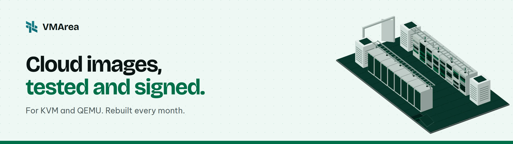

<p align="center">
  
</p>

<p align="center">
  <a href="https://github.com/VMArea/cloud-images/releases/latest"></a>
  <a href="LICENSE"></a>
  <a href="https://images.vmarea.com"></a>
</p>

Ready-to-boot qcow2 images for KVM and QEMU with cloud-init. Each one starts from the vendor's official image, is verified, customised, booted and tested, then signed. New builds ship every month.

## Images

| OS | Versions |
|---|---|
| Debian | 12, 13 |
| AlmaLinux | 8, 9, 10 |
| Rocky Linux | 8, 9, 10 |
| CentOS Stream | 9, 10 |
| Fedora | 43, 44 |
| openSUSE Leap | 16.0 |
| Arch Linux | rolling |
| FreeBSD | 14.5, 15.1 |

Download from the [latest release](https://github.com/VMArea/cloud-images/releases/latest) or browse [images.vmarea.com](https://images.vmarea.com) for build dates, test results and vulnerability counts.

Ubuntu and Windows Server recipes are here too, but those images are not published: Ubuntu's trademark policy and Windows licensing do not allow it. Build them yourself.

## Quick start

Verify, then boot with a cloud-init seed:

```sh
curl -LO https://raw.githubusercontent.com/VMArea/cloud-images/main/publish/cosign.pub
cosign verify-blob --key cosign.pub --bundle SHA256SUMS.sig --insecure-ignore-tlog SHA256SUMS
sha256sum --ignore-missing -c SHA256SUMS

printf '#cloud-config\nuser: root\npassword: change-me\nchpasswd: {expire: false}\n' > user-data
cloud-localds seed.iso user-data
qemu-img resize debian-13-*.qcow2 20G
qemu-system-x86_64 -enable-kvm -m 2048 -nic user,model=virtio \
  -drive file=debian-13-*.qcow2,if=virtio -drive file=seed.iso,if=virtio
```

Log in as `root`. The disk grows to fill its size on first boot.

## What's inside

- QEMU guest agent and cloud-init, ready for password, SSH key, hostname and network.
- Security updates on first boot, a swap file sized to RAM, UTC and `en_US.UTF-8`.
- A few everyday tools: curl, wget, nano, vim, htop, unzip.
- No machine ID, SSH host keys, logs or build leftovers.

## Build it yourself

```sh
./build os/debian/13.yaml
./test output/debian-13-<date>.qcow2
```

Needs Linux with KVM. See [docs/building.md](docs/building.md) for requirements and recipe fields, [TESTING.md](TESTING.md) for the checks, and [windows/](windows/) for Windows Server.

## Security

Every release has a signed `SHA256SUMS`, an SBOM and a vulnerability scan per image. Vendor checksums and signatures are verified before anything is built. Report problems as described in [SECURITY.md](SECURITY.md).

## Contributing

Issues and pull requests are welcome. See [CONTRIBUTING.md](CONTRIBUTING.md).

## Licence

[MIT](LICENSE). Each distribution keeps its own licences and trademarks.
